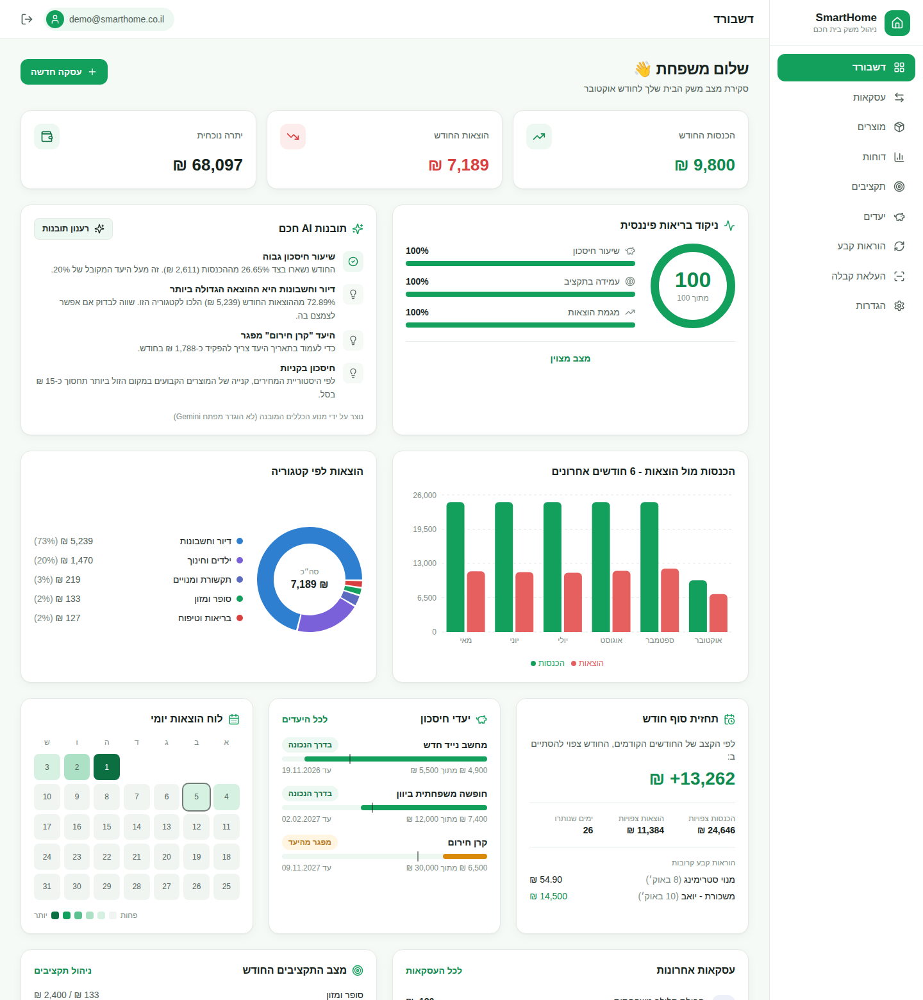

<div dir="rtl">

# SmartHome – ניהול משק בית חכם

מערכת Web לניהול הכספים של משק הבית, ובה:

- הכנסות והוצאות, תקציבים, יעדי חיסכון והוראות קבע.
- קבלות שמפורקות אוטומטית למוצרים.
- השוואת מחירים בין בתי עסק.



## יכולות

| | |
|---|---|
| **ראשי** | כמה נשאר החודש, תחזית לסוף החודש והחיובים הקרובים, מצב התקציבים והעסקאות האחרונות. שלושה כפתורים להוספה: הוצאה, הכנסה וקבלה |
| **עסקאות** | הוספה, עריכה, חיפוש וסינון (לפי חודש ולפי כרטיס), ייצוא Excel. הוצאה אחת יכולה להתפרט לכמה מוצרים |
| **ייבוא קובץ** | כפתור אחד לכל קובץ: דף עו״ש ופירוט אשראי (‎.xlsx, ‎.xls, HTML, CSV) או קובץ Excel בתבנית של האפליקציה. בדיקה של כל שורה לפני השמירה, קטגוריה אוטומטית לפי ההיסטוריה, וזיהוי של מה שכבר יובא ושל חיוב הכרטיס בעו״ש כדי לא לספור פעמיים |
| **כרטיסים** | כמה יצא מכל כרטיס וחשבון בכל חודש, פילוח לקטגוריות, החיוב הבא, ופירוט לפי מועד חיוב |
| **דוחות** | סיכום חודשי (הכנסות, הוצאות שוטפות, הוראות קבע, מעשרות ומאזן), הכנסות מול הוצאות ב‑12 החודשים האחרונים, השוואה לחודש הקודם ותובנות AI. כאן אפשר גם להשוות בין חודש לועזי לעברי |
| **תכנון** | ארבע לשוניות: **תקציבים** (תקרה חודשית לקטגוריה והתראת מייל לפני חריגה), **הוראות קבע** (תשלומים והכנסות קבועים שנרשמים לבד), **מעשרות** (יעד חודשי ורישום תרומות) ו**יעדי חיסכון** (סכום, תאריך והפקדות) |
| **קבלות ומוצרים** | צילום או PDF, פענוח ב‑Google Gemini וכל מוצר נשמר כעסקה נפרדת. כל הקבלות עם הקובץ המקורי, והיסטוריית מחירים לכל מוצר עם המקום הכי משתלם. אותו מוצר בכתיב אחר מתאחד |
| **Google Sheets** | גיבוי או סנכרון דו‑כיווני: טאב עסקאות וטאב סיכום חודשי, ידנית ובכל לילה |
| **טלפון** | אפליקציית Web שאפשר להתקין ממסך הבית, סרגל ניווט תחתון, וכפתור להוספת הוצאה בלחיצה אחת |
| **הגדרות** | בכפתור המשתמש למעלה: פרופיל, לוח שנה (לועזי או עברי, לכל המסכים), אבטחה, Google Sheets וקטגוריות |
| **חשבון** | כניסה רק לכתובות מורשות, אימות דו‑שלבי באפליקציה, נעילה אחרי ניסיונות כושלים, אימות מייל בקוד, איפוס סיסמה בקישור, התחברות עם Google, וניתוק כל המכשירים בהחלפת סיסמה |

## טכנולוגיות

- **צד לקוח:** React 18, Vite, Tailwind CSS, React Router, Recharts, Axios.
- **צד שרת:** Node.js, Express, Mongoose, Joi, JWT (access + refresh), Nodemailer, node‑cron, ExcelJS.
- **מסד נתונים:** MongoDB. בפיתוח הוא עולה אוטומטית, בלי התקנה.
- **שירותים חיצוניים:** Google Gemini API, SMTP, Google OAuth.
- **DevOps:** Docker, docker‑compose, nginx, GitHub Actions.

## הפעלה בלחיצה כפולה (Windows)

לא צריך להתקין שום דבר מראש.

1. בעמוד הפרויקט ב‑GitHub: **Code** ← **Download ZIP**, ולחלץ את הקובץ לתיקייה, למשל `C:\SmartHome`.
2. ללחוץ פעמיים על **`SmartHome.exe`** שבתיקייה הראשית.
3. אם מופיעה ההודעה "Windows protected your PC": ללחוץ **More info** ואז **Run anyway**. ההודעה מופיעה כי הקובץ לא חתום, ורק בפעם הראשונה.

**בפעם הראשונה** ההפעלה לוקחת כמה דקות, וצריך חיבור לאינטרנט. החלון מראה מה קורה:
- מורידים את Node.js אם הוא לא מותקן במחשב. ההורדה נשמרת ב‑`%LOCALAPPDATA%\SmartHome`.
- מתקינים את הרכיבים ומכינים את המסכים.
- כותבים את `backend\.env` עם סודות חדשים של המחשב הזה.

**בפעמים הבאות** המערכת עולה תוך כמה שניות ונפתחת בדפדפן בכתובת http://localhost:5180.

- **כל עוד החלון פתוח, המערכת פועלת.** אפשר למזער אותו. סגירת החלון שומרת את הנתונים ועוצרת את המערכת.
- **רק המחשב הזה יכול להיכנס.** המערכת לא פתוחה לרשת הביתית או לאינטרנט.
- **אחרי עדכון מ‑GitHub:** מחלצים את הגרסה החדשה, ו‑`SmartHome.exe` מתקין ובונה מחדש רק את מה שהשתנה.
- **הנתונים נשמרים במחשב**, בתיקייה `backend\.data`. הם לא עוברים עם הקוד ל‑GitHub. כדי להעביר אותם למחשב אחר, או לגרסה חדשה שחולצה לתיקייה אחרת, סוגרים את המערכת ומעתיקים את התיקייה `backend\.data` לאותו מקום בתיקייה החדשה. כדאי להעתיק גם את `backend\.env`, כי בלעדיו אימות דו‑שלבי שהופעל לא ייקרא.
- **אם משהו נכשל:** החלון אומר מה, והכפתור "פרטי התקלה" פותח את `smarthome.log`.

המקור של `SmartHome.exe` נמצא ב‑`launcher/SmartHome.cs`. בונים אותו מחדש עם `powershell -ExecutionPolicy Bypass -File launcher\build.ps1`, בעזרת המהדר שמגיע עם Windows.

## התחלה מהירה (פיתוח)

דרישות: Node.js 20.19 ומעלה (או 22.13 ומעלה). זה הכל.

```bash
npm run setup                          # מתקין תלויות בשורש, ב-backend וב-frontend
cp backend/.env.example backend/.env   # ולקבוע JWT_SECRET ו-JWT_REFRESH_SECRET
npm run seed                           # לא חובה: נתוני הדגמה
npm run dev                            # שרת + לקוח יחד
```

- **האפליקציה:** http://localhost:5173. Vite מעביר כל בקשה ל‑`/api` לשרת שבפורט 5000.
- **משתמש הדגמה:** `demo@smarthome.co.il` / `Demo1234`.

### מסד הנתונים

כש‑`MONGO_URI` ריק (ברירת המחדל בפיתוח), השרת מפעיל MongoDB מוטמע בעזרת `mongodb-memory-server`:

- **הורדה ראשונה:** כ‑600MB, חד‑פעמית.
- **שמירת נתונים:** ב‑`backend/.data/db`, והם נשמרים בין הרצות.
- **Compass:** אפשר להתחבר בכתובת `mongodb://127.0.0.1:27018`.
- **פורט:** 27018 ולא 27017, כדי לא להתנגש ב‑MongoDB אחר שכבר רץ על המחשב. אפשר לשנות אותו ב‑`EMBEDDED_MONGO_PORT`.
- **פקודות נוספות:** `npm run seed` שמורץ בזמן שהשרת פועל מתחבר לאותו מסד.

לעבודה מול שרת אמיתי (התקנה מקומית או [Atlas](https://www.mongodb.com/atlas)) מגדירים `MONGO_URI`. ב‑production זה חובה.

### הרצה ב‑Docker

```bash
cp .env.example .env          # לקבוע JWT_SECRET ו-JWT_REFRESH_SECRET
docker compose up -d --build  # http://localhost:8080
docker compose exec api node src/seed/seed.js   # לא חובה: נתוני הדגמה
```

> ב‑Docker הקוד רץ במצב production, ועוגיית ההתחברות נשלחת רק ב‑HTTPS. ב‑`localhost` דפדפנים מרשים זאת, אבל בכתובת אחרת צריך HTTPS, אחרת ההתחברות לא תישמר. ההרשמה סגורה עד שמגדירים `ALLOWED_EMAILS`.

## העלאה לאוויר

הקובץ `render.yaml` מגדיר שירות אחד ב‑[Render](https://render.com), שבונה את ה‑`Dockerfile` שבשורש הפרויקט. השרת מגיש גם את האפליקציה, מאותה כתובת. הבנייה רצה אצל Render ולא צורכת דקות של GitHub Actions. אותו `Dockerfile` מתאים גם לכל מארח אחר שמריץ קונטיינרים.

**1. מסד נתונים ב‑[MongoDB Atlas](https://www.mongodb.com/atlas):**

1. יוצרים Cluster באזור קרוב, למשל Frankfurt.
2. יוצרים משתמש למסד עם סיסמה ארוכה ואקראית, ושומרים את כתובת החיבור.
3. ב‑Network Access מוסיפים את הכתובות היוצאות של השירות, כפי שמופיעות ב‑Render תחת Connect. בלי זה לא ניתן להתחבר.

**2. השירות ב‑Render:** New → Blueprint, בוחרים את המאגר, וממלאים:

| משתנה | ערך |
|---|---|
| `MONGO_URI` | כתובת החיבור מ‑Atlas |
| `CLIENT_URL` | הכתובת של השירות, למשל `https://smarthome.onrender.com` |
| `ALLOWED_EMAILS` | הכתובות שמותר להן לפתוח חשבון, מופרדות בפסיק |

`JWT_SECRET`, `JWT_REFRESH_SECRET` ו‑`ENCRYPTION_KEY` נוצרים אוטומטית. כדאי לשמור עותק של `ENCRYPTION_KEY`: בלעדיו אי אפשר לקרוא הגדרות אימות דו‑שלבי קיימות.

**3. אחרי העלייה:**

1. נרשמים עם הכתובת המורשית.
2. בהגדרות מפעילים אימות דו‑שלבי ושומרים את קודי הגיבוי.
3. שומרים את הסיסמה במנהל סיסמאות. בלי SMTP אין איפוס סיסמה בפרודקשן, כי הקישור לא נכתב ל‑log.
4. בטלפון: Safari ← שיתוף ← "הוספה למסך הבית", או Chrome ← "התקנת האפליקציה".

**התוכנית החינמית של Render:** `render.yaml` מוגדר עליה. השירות נרדם אחרי 15 דקות ללא תנועה, והכניסה הבאה לוקחת כדקה. הוראות קבע וגיבוי ל‑Sheets שהוחמצו בזמן השינה רצים בהתעוררות. פורטי SMTP חסומים בה, ולכן אין לה מיילים, ואסור להגדיר בה `SMTP_*`: ההרשמה תחכה לקוד אימות שלא יגיע. כדי לקבל מיילים ושירות ער תמיד, משנים ל‑`plan: starter`.

**גיבוי:** כדאי לוודא איזה גיבוי כלול בתוכנית של Atlas שבחרתם. בכל מקרה, חיבור ל‑Google Sheets נותן עותק נוסף של העסקאות בכל לילה. קבצי הקבלות לא נכללים בו.

## הגדרת השירותים החיצוניים

כולם אופציונליים, והמערכת עובדת גם בלעדיהם. ההגדרות נכתבות ב‑`backend/.env`, ואחרי שינוי מפעילים מחדש את השרת.

| שירות | משתנים | בלי הגדרה |
|---|---|---|
| Google Gemini | `GEMINI_API_KEY`, `GEMINI_MODEL` ([יצירת מפתח](https://aistudio.google.com/apikey)) | העלאת קבלה מחזירה קבלת הדגמה, ותובנות מחושבות במנוע כללים מקומי |
| דואר (SMTP) | `SMTP_HOST`, `SMTP_PORT`, `SMTP_USER`, `SMTP_PASS`, `MAIL_FROM` | מיילים נרשמים ל‑log של השרת, כולל קישור איפוס הסיסמה, וחשבונות חדשים לא צריכים אימות מייל |
| התחברות עם Google | `GOOGLE_CLIENT_ID`, `GOOGLE_CLIENT_SECRET`, `GOOGLE_CALLBACK_URL` | כפתור Google לא מוצג |
| Google Sheets | `GOOGLE_SERVICE_ACCOUNT_JSON` | כרטיס Sheets בהגדרות מסביר שהחיבור לא הוגדר |

**Google Sheets:**

1. ב‑[Google Cloud Console](https://console.cloud.google.com) מפעילים את Google Sheets API בפרויקט.
2. יוצרים Service Account ומורידים מפתח JSON. זה מפתח סודי: לא מכניסים אותו למאגר.
3. שמים את תוכן הקובץ ב‑`GOOGLE_SERVICE_ACCOUNT_JSON`, כשורה אחת או בקידוד base64.
4. בהגדרות באפליקציה מופיעה כתובת חשבון השירות. משתפים איתה גיליון אחד כעורך ומדביקים את הקישור. לחשבון אין גישה לשום קובץ אחר.

כללי הסנכרון הדו‑כיווני: עריכה ושורה חדשה בגיליון נכנסות למערכת. מחיקת שורה בגיליון לא מוחקת מהמערכת, והשורה חוזרת בסנכרון הבא. שורה שנערכה בשני הצדדים נשארת כפי שהיא במערכת, ומופיעה בדוח הסנכרון. שורה שאי אפשר לקרוא נשארת בגיליון ומדווחת.

**Gmail כשרת SMTP:** מפעילים אימות דו‑שלבי ויוצרים [סיסמת אפליקציה](https://myaccount.google.com/apppasswords). אחר כך מגדירים:

- `SMTP_HOST=smtp.gmail.com`
- `SMTP_USER=הכתובת שלכם`
- `SMTP_PASS=סיסמת האפליקציה`

**התחברות עם Google:**

1. ב‑[Google Cloud Console](https://console.cloud.google.com/apis/credentials) יוצרים OAuth client ID מסוג Web application.
2. ב‑Authorized redirect URIs מוסיפים בדיוק את `GOOGLE_CALLBACK_URL`. בפיתוח: `http://localhost:5000/api/auth/google/callback`.

**Gemini עמוס:** אם השירות של Google עמוס או שהמכסה נגמרה, המשתמש מקבל הודעה שינסה שוב בעוד כמה דקות. התובנות בדוחות עוברות אוטומטית למנוע הכללים המקומי.

## פקודות

| פקודה (מהשורש) | תיאור |
|---|---|
| `npm run dev` | שרת וקליינט יחד, עם טעינה מחדש |
| `npm run seed` | טעינת נתוני הדגמה |
| `npm test` | בדיקות Jest: יחידה, ובדיקות קצה לקצה של ההתחברות מול MongoDB אמיתי בזיכרון |
| `npm run lint` | בדיקת איכות קוד בשני הצדדים |
| `npm run build` | בניית צד הלקוח ל‑production |
| `npm --prefix backend run smoke` | בדיקת קצה לקצה מול שרת פעיל |

## מבנה הפרויקט

```
SmartHome/
├── backend/src/
│   ├── routes/ → middleware/ → validators/ → controllers/ → managers/ → repositories/ → models/
│   ├── services/     Gemini, דואר, Google, Excel, JWT
│   ├── jobs/         הוראות קבע, סיכום חודשי
│   └── config/ utils/ seed/
├── backend/tests/    בדיקות Jest
├── frontend/src/
│   └── pages/ components/ context/ hooks/ services/ routes/ utils/ constants/
├── docs/             ספר הפרויקט, תיעוד API, צילומי מסך (והגרסה הקודמת ב-archive/)
└── docker-compose.yml
```

## תיעוד

- [ספר הפרויקט](docs/project-book.md): דרישות, ארכיטקטורה, מודל נתונים, אבטחה, תרשימים, מסכים ובדיקות.
- [תיעוד ה‑API](docs/api.md).

</div>
