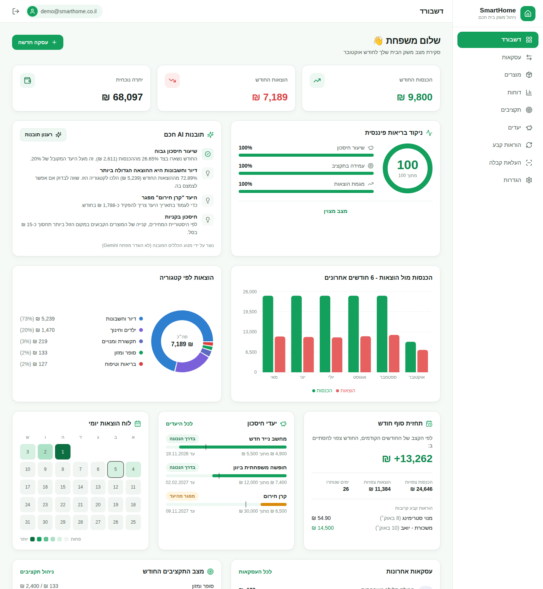

<div dir="rtl">

# SmartHome – ניהול משק בית חכם

מערכת Web לניהול הכספים של משק הבית, ובה:

- הכנסות והוצאות, תקציבים, יעדי חיסכון והוראות קבע.
- קבלות שמפורקות אוטומטית למוצרים.
- השוואת מחירים בין בתי עסק.



## יכולות

| | |
|---|---|
| **דשבורד** | סיכום חודשי, ניקוד בריאות פיננסית, תובנות AI, תחזית סוף חודש, גרפים ולוח הוצאות יומי |
| **עסקאות** | הוספה, עריכה, חיפוש וסינון, יצוא ויבוא Excel. קנייה אחת עם כמה מוצרים, או העלאת קבלה ישר מחלון ההוספה |
| **העלאת קבלה** | צילום או PDF, פענוח ב‑Google Gemini, וכל מוצר נשמר כעסקה נפרדת |
| **הקבלות שלי** | כל הקבלות שהועלו, עם הקובץ המקורי והמוצרים שנשמרו מכל אחת |
| **מוצרים** | היסטוריית מחירים לכל מוצר, ואיפה הכי משתלם לקנות אותו שוב |
| **תקציבים** | תקרה חודשית לקטגוריה, והתראת מייל לפני חריגה |
| **יעדי חיסכון** | סכום ותאריך יעד, הפקדות, חיווי אם אתם בקצב, והתראה כשההוצאות של החודש לא משאירות מספיק ליעדים |
| **הוראות קבע** | תשלומים והכנסות קבועים שנרשמים לבד |
| **דוחות** | סיכום חודשי והשוואה לחודש הקודם |
| **חשבון** | אימות מייל בקוד, איפוס סיסמה בקישור, התחברות עם Google, וניתוק כל המכשירים בהחלפת סיסמה |

## טכנולוגיות

- **צד לקוח:** React 18, Vite, Tailwind CSS, React Router, Recharts, Axios.
- **צד שרת:** Node.js, Express, Mongoose, Joi, JWT (access + refresh), Nodemailer, node‑cron, ExcelJS.
- **מסד נתונים:** MongoDB. בפיתוח הוא עולה אוטומטית, בלי התקנה.
- **שירותים חיצוניים:** Google Gemini API, SMTP, Google OAuth.
- **DevOps:** Docker, docker‑compose, nginx, GitHub Actions.

## התחלה מהירה

דרישות: Node.js 18 ומעלה. זה הכל.

```bash
npm run setup                          # מתקין תלויות בשורש, ב-backend וב-frontend
cp backend/.env.example backend/.env   # ולקבוע JWT_SECRET ו-JWT_REFRESH_SECRET
npm run seed                           # לא חובה: נתוני הדגמה
npm run dev                            # שרת + לקוח יחד
```

- **האפליקציה:** http://localhost:5173. Vite מעביר כל בקשה ל‑`/api` לשרת שבפורט 5000.
- **משתמש הדגמה:** `demo@smarthome.co.il` / `Demo1234`.

### מסד הנתונים

כש‑`MONGO_URI` ריק (ברירת המחדל בפיתוח), השרת מפעיל MongoDB מוטמע בעזרת `mongodb-memory-server`:

- **הורדה ראשונה:** כ‑600MB, חד‑פעמית.
- **שמירת נתונים:** ב‑`backend/.data/db`, והם נשמרים בין הרצות.
- **Compass:** אפשר להתחבר בכתובת `mongodb://127.0.0.1:27018`.
- **פורט:** 27018 ולא 27017, כדי לא להתנגש ב‑MongoDB אחר שכבר רץ על המחשב. אפשר לשנות אותו ב‑`EMBEDDED_MONGO_PORT`.
- **פקודות נוספות:** `npm run seed` שמורץ בזמן שהשרת פועל מתחבר לאותו מסד.

לעבודה מול שרת אמיתי (התקנה מקומית או [Atlas](https://www.mongodb.com/atlas)) מגדירים `MONGO_URI`. ב‑production זה חובה.

### הרצה ב‑Docker

```bash
cp .env.example .env          # לקבוע JWT_SECRET ו-JWT_REFRESH_SECRET
docker compose up -d --build  # http://localhost:8080
docker compose exec api node src/seed/seed.js   # לא חובה: נתוני הדגמה
```

## הגדרת השירותים החיצוניים

כולם אופציונליים, והמערכת עובדת גם בלעדיהם. ההגדרות נכתבות ב‑`backend/.env`, ואחרי שינוי מפעילים מחדש את השרת.

| שירות | משתנים | בלי הגדרה |
|---|---|---|
| Google Gemini | `GEMINI_API_KEY`, `GEMINI_MODEL` ([יצירת מפתח](https://aistudio.google.com/apikey)) | העלאת קבלה מחזירה קבלת הדגמה, ותובנות מחושבות במנוע כללים מקומי |
| דואר (SMTP) | `SMTP_HOST`, `SMTP_PORT`, `SMTP_USER`, `SMTP_PASS`, `MAIL_FROM` | מיילים נרשמים ל‑log של השרת, כולל קישור איפוס הסיסמה, וחשבונות חדשים לא צריכים אימות מייל |
| התחברות עם Google | `GOOGLE_CLIENT_ID`, `GOOGLE_CLIENT_SECRET`, `GOOGLE_CALLBACK_URL` | כפתור Google לא מוצג |

**Gmail כשרת SMTP:** מפעילים אימות דו‑שלבי ויוצרים [סיסמת אפליקציה](https://myaccount.google.com/apppasswords). אחר כך מגדירים:

- `SMTP_HOST=smtp.gmail.com`
- `SMTP_USER=הכתובת שלכם`
- `SMTP_PASS=סיסמת האפליקציה`

**התחברות עם Google:**

1. ב‑[Google Cloud Console](https://console.cloud.google.com/apis/credentials) יוצרים OAuth client ID מסוג Web application.
2. ב‑Authorized redirect URIs מוסיפים בדיוק את `GOOGLE_CALLBACK_URL`. בפיתוח: `http://localhost:5000/api/auth/google/callback`.

**Gemini עמוס:** אם השירות של Google עמוס או שהמכסה נגמרה, המשתמש מקבל הודעה שינסה שוב בעוד כמה דקות. התובנות בדשבורד עוברות אוטומטית למנוע הכללים המקומי.

## פקודות

| פקודה (מהשורש) | תיאור |
|---|---|
| `npm run dev` | שרת וקליינט יחד, עם טעינה מחדש |
| `npm run seed` | טעינת נתוני הדגמה |
| `npm test` | בדיקות Jest: יחידה, ובדיקות קצה לקצה של ההתחברות מול MongoDB אמיתי בזיכרון |
| `npm run lint` | בדיקת איכות קוד בשני הצדדים |
| `npm run build` | בניית צד הלקוח ל‑production |
| `npm --prefix backend run smoke` | בדיקת קצה לקצה מול שרת פעיל |

## מבנה הפרויקט

```
SmartHome/
├── backend/src/
│   ├── routes/ → middleware/ → validators/ → controllers/ → managers/ → repositories/ → models/
│   ├── services/     Gemini, דואר, Google, Excel, JWT
│   ├── jobs/         הוראות קבע, סיכום חודשי
│   └── config/ utils/ seed/
├── backend/tests/    בדיקות Jest
├── frontend/src/
│   └── pages/ components/ context/ hooks/ services/ routes/ utils/ constants/
├── docs/             ספר הפרויקט, תיעוד API, צילומי מסך (והגרסה הקודמת ב-archive/)
└── docker-compose.yml
```

## תיעוד

- [ספר הפרויקט](docs/project-book.md): דרישות, ארכיטקטורה, מודל נתונים, אבטחה, תרשימים, מסכים ובדיקות.
- [תיעוד ה‑API](docs/api.md).

</div>
