# SmartHome – ניהול משק בית חכם

## ספר פרויקט

| | |
|---|---|
| **שם הפרויקט** | SmartHome – ניהול משק בית חכם |
| **מגמה** | הנדסת תוכנה – טכנאי תוכנה (מה"ט) |
| **מגיש/ה** | _להשלמה_ |
| **ת"ז** | _להשלמה_ |
| **מנחה** | _להשלמה_ |
| **מכללה** | _להשלמה_ |
| **תאריך הגשה** | _להשלמה_ |

---

## תוכן עניינים

1. [מבוא](#1-מבוא)
2. [דרישות המערכת](#2-דרישות-המערכת)
3. [טכנולוגיות](#3-טכנולוגיות)
4. [ארכיטקטורה](#4-ארכיטקטורה)
5. [מודל הנתונים](#5-מודל-הנתונים)
6. [ממשק ה‑API](#6-ממשק-ה-api)
7. [אבטחת מידע](#7-אבטחת-מידע)
8. [שירותים חיצוניים](#8-שירותים-חיצוניים)
9. [תרשימי תכנון](#9-תרשימי-תכנון)
10. [אלגוריתמים מרכזיים](#10-אלגוריתמים-מרכזיים)
11. [מסכי המערכת](#11-מסכי-המערכת)
12. [בדיקות](#12-בדיקות)
13. [התקנה, הרצה ופריסה](#13-התקנה-הרצה-ופריסה)
14. [ניהול גרסאות](#14-ניהול-גרסאות)
15. [סיכום והרחבות עתידיות](#15-סיכום-והרחבות-עתידיות)

---

## 1. מבוא

### 1.1 הרקע והבעיה

משק בית ממוצע מנהל עשרות תנועות כספיות בחודש: משכורות, שכר דירה, חשבונות, מנויים וקניות. המידע מפוזר בין אפליקציית הבנק, חברות האשראי, קבלות נייר וגיליונות אקסל, ולכן קשה לענות על שאלות פשוטות: כמה הוצאנו החודש על אוכל? האם נעמוד בתקציב? איפה זול יותר לקנות את המוצרים שאנחנו קונים כל שבוע?

### 1.2 הפתרון

SmartHome היא מערכת Web שמרכזת את כל ההכנסות וההוצאות של משק הבית במקום אחד, ומוסיפה מעליהן שכבת ניתוח:

- **תיעוד מהיר** – הזנה ידנית, יבוא מקובץ Excel, הוראות קבע שנרשמות לבד, וצילום קבלה שמפורק אוטומטית למוצרים.
- **תכנון** – תקציב חודשי לכל קטגוריה עם התראה לפני חריגה, ויעדי חיסכון עם מעקב אחר הקצב.
- **תובנות** – דשבורד, ניקוד בריאות פיננסית, תחזית לסוף החודש, דוחות חודשיים, והשוואת מחירי מוצרים בין בתי עסק.

### 1.3 קהל היעד

משפחות ויחידים שרוצים שליטה בתקציב החודשי בלי ידע חשבונאי, בממשק בעברית מלאה (RTL) שמתאים גם לטלפון.

### 1.4 מטרות הפרויקט

1. לבנות מערכת Full‑Stack מלאה: צד לקוח ב‑React, צד שרת ב‑Node.js, מסד נתונים MongoDB.
2. ליישם ארכיטקטורת שכבות ברורה שקל לתחזק ולהרחיב.
3. ליישם אבטחת מידע ברמת האפליקציה: אימות, הרשאות, ולידציה והפרדת נתונים בין משתמשים.
4. לשלב שני שירותים חיצוניים: בינה מלאכותית (Google Gemini) ושליחת דואר (SMTP).
5. לספק סביבת הרצה ופריסה מסודרת: Docker, docker‑compose ו‑CI.

---

## 2. דרישות המערכת

### 2.1 דרישות פונקציונליות

| # | תחום | דרישה |
|---|---|---|
| F1 | משתמשים | הרשמה, התחברות והתנתקות. עדכון פרופיל והחלפת סיסמה |
| F2 | עסקאות | הוספה, עריכה ומחיקה של הכנסות והוצאות, כולל בית עסק ופירוט מוצר |
| F3 | עסקאות | חיפוש חופשי וסינון לפי סוג, קטגוריה וטווח תאריכים, עם דפדוף |
| F4 | Excel | יצוא העסקאות המסוננות לקובץ `.xlsx` |
| F5 | Excel | יבוא מקובץ `.xlsx` / `.csv` עם תצוגה מקדימה וסימון שורות שגויות |
| F6 | קטגוריות | קטגוריות ברירת מחדל לכל משתמש חדש, וניהול קטגוריות אישיות (שם, צבע, אייקון) |
| F7 | תקציבים | תקציב חודשי לקטגוריה, מעקב ניצול, סף התראה ומייל בחריגה |
| F8 | יעדים | יעד חיסכון עם סכום ותאריך, הפקדות ומשיכות, וחיווי "בדרך הנכונה / מפגר" |
| F9 | הוראות קבע | תשלום או הכנסה חוזרים (יומי, שבועי, חודשי, שנתי) שנרשמים אוטומטית, השהיה וביצוע מיידי |
| F10 | קבלות | העלאת תמונה או PDF, פענוח ב‑AI, בדיקה ותיקון, ושמירת כל מוצר כעסקה נפרדת |
| F11 | מוצרים | קטלוג מוצרים מתוך הקבלות: היסטוריית מחירים והמקום המשתלם ביותר לקנייה |
| F12 | דשבורד | סיכום חודשי, גרף 6 חודשים, פילוח קטגוריות, לוח הוצאות יומי, ניקוד בריאות ותחזית |
| F13 | דוחות | דוח חודשי עם השוואה לחודש הקודם |
| F14 | תובנות | המלצות טקסטואליות על בסיס הנתונים (Gemini או מנוע כללים) |
| F15 | התראות | מייל ברוכים הבאים, התראת תקציב וסיכום חודשי |

### 2.2 דרישות לא פונקציונליות

| # | תחום | דרישה |
|---|---|---|
| N1 | אבטחה | סיסמאות מגובבות, JWT, הגבלת קצב, ולידציית קלט, בידוד נתונים בין משתמשים |
| N2 | שימושיות | ממשק בעברית מלאה, RTL, רספונסיבי מ‑360px, ניווט מקלדת ו‑focus נראה |
| N3 | ביצועים | אינדקסים על שדות השאילתה, דפדוף בצד השרת, טעינה עצלה של מסכים משניים |
| N4 | תחזוקתיות | הפרדה לשכבות, קבצים קטנים בעלי אחריות אחת, ESLint ו‑Prettier |
| N5 | אמינות | טיפול שגיאות מרכזי, כיבוי מסודר של השרת, כשל במייל לא מפיל פעולה עסקית |
| N6 | ניידות | הרצה מקומית בפקודה אחת או ב‑Docker, הגדרות דרך משתני סביבה בלבד |

---

## 3. טכנולוגיות

| שכבה | טכנולוגיה | למה נבחרה |
|---|---|---|
| צד לקוח | React 18, Vite | ספריית UI מבוססת קומפוננטות, כלי build מהיר |
| ניתוב | React Router 6 | ניתוב צד לקוח עם נתיבים מוגנים וטעינה עצלה |
| עיצוב | Tailwind CSS 3 | מערכת עיצוב עקבית דרך טוקנים, תמיכה ב‑RTL עם מאפיינים לוגיים |
| גרפים | Recharts | גרפים דקלרטיביים כקומפוננטות React |
| HTTP | Axios | Interceptors לצירוף ה‑token ולטיפול אחיד בשגיאות |
| צד שרת | Node.js 22, Express 4 | סביבת JavaScript אחת לשני הצדדים, מערכת middleware בשלה |
| מסד נתונים | MongoDB 7, Mongoose 8 | מודל מסמכים גמיש שמתאים לקבלות עם מספר פריטים משתנה |
| ולידציה | Joi | סכמות דקלרטיביות וסינון שדות לא מוכרים |
| אימות | jsonwebtoken, bcryptjs | אימות חסר מצב (stateless), גיבוב סיסמאות עם salt |
| אבטחה | helmet, cors, express‑rate‑limit, express‑mongo‑sanitize, hpp | הקשחת HTTP והגנה מפני הזרקות |
| קבצים | multer, ExcelJS | העלאת קבצים לזיכרון, קריאה וכתיבה של Excel |
| תזמון | node‑cron | הרצת הוראות קבע וסיכום חודשי |
| AI | Google Gemini API | פענוח תמונת קבלה לנתונים מובנים, הפקת תובנות |
| דואר | Nodemailer (SMTP) | שליחת התראות |
| בדיקות | Jest | בדיקות יחידה |
| DevOps | Docker, docker‑compose, nginx, GitHub Actions | סביבה אחידה, פריסה ו‑CI |

---

## 4. ארכיטקטורה

### 4.1 מבט על

המערכת בנויה בארכיטקטורת שלוש שכבות (3‑Tier): לקוח, שרת יישומים ומסד נתונים. הלקוח הוא אפליקציית SPA שמתקשרת עם השרת ב‑REST API בלבד.

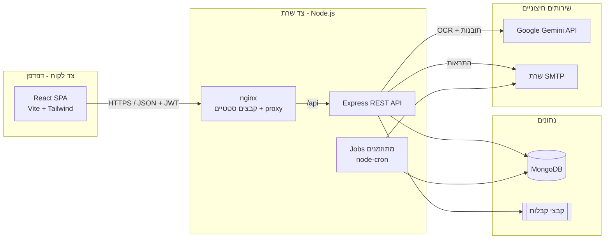

### 4.2 שכבות צד השרת

כל בקשה עוברת באותו מסלול, ולכל שכבה אחריות אחת:

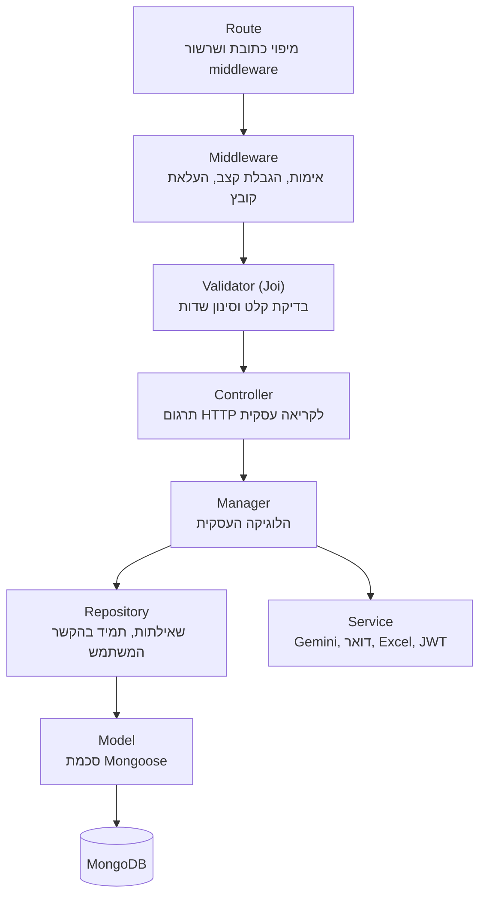

| שכבה | תיקייה | אחריות | לא מכירה את |
|---|---|---|---|
| Route | `routes/` | הגדרת נתיבים ושרשור middleware | מסד הנתונים |
| Middleware | `middleware/` | אימות JWT, ולידציה, הגבלת קצב, העלאות, טיפול שגיאות | לוגיקה עסקית |
| Validator | `validators/` | סכמות Joi לכל בקשה | Express |
| Controller | `controllers/` | קריאה ל‑manager והחזרת תשובה אחידה | Mongoose |
| Manager | `managers/` | חוקים עסקיים, חישובים ותיאום בין ישויות | `req` / `res` |
| Repository | `repositories/` | גישה לנתונים, מסוננת תמיד לפי המשתמש | HTTP |
| Model | `models/` | סכמה, אינדקסים ו‑hooks | – |
| Service | `services/` | עטיפה לשירותים חיצוניים ולספריות | ישויות עסקיות |
| Utils | `utils/` | פונקציות טהורות: תאריכים, חישובים פיננסיים, שגיאות | – |
| Jobs | `jobs/` | משימות מתוזמנות | HTTP |

היתרון: אפשר להחליף את מסד הנתונים בלי לגעת ב‑managers, ולבדוק את החישובים הפיננסיים בלי מסד נתונים כלל.

### 4.3 מבנה הפרויקט

```
smarthome/
├── backend/
│   ├── src/
│   │   ├── config/         env, db, mailer, constants
│   │   ├── models/         User, Category, Transaction, Budget, RecurringPayment, SavingsGoal, Receipt
│   │   ├── repositories/   base.repository + repository לכל ישות
│   │   ├── managers/       auth, category, transaction, budget, goal, recurring,
│   │   │                   receipt, product, dashboard, report, insight
│   │   ├── services/       gemini, email, excel, token
│   │   ├── controllers/    controller לכל משאב
│   │   ├── routes/         router לכל משאב + index
│   │   ├── validators/     סכמות Joi
│   │   ├── middleware/     auth, validate, rateLimiter, upload, errorHandler
│   │   ├── utils/          ApiError, asyncHandler, response, dateUtils, finance, text, fileSignature, logger
│   │   ├── jobs/           recurring.job, monthlySummary.job
│   │   ├── seed/           נתוני הדגמה וקטגוריות ברירת מחדל
│   │   ├── app.js          הרכבת Express
│   │   └── server.js       נקודת כניסה, כיבוי מסודר
│   ├── tests/              בדיקות Jest
│   └── Dockerfile
├── frontend/
│   ├── src/
│   │   ├── pages/          מסך לכל נתיב
│   │   ├── components/     ui, layout, dashboard, transactions, budgets, goals,
│   │   │                   recurring, products, receipts, settings
│   │   ├── context/        Auth, Categories, Toast
│   │   ├── hooks/          useFetch, useAction, useDebounce
│   │   ├── services/       שכבת API (axios) לכל משאב
│   │   ├── routes/         AppRouter, ProtectedRoute
│   │   ├── utils/          עיצוב מספרים ותאריכים, הורדת קבצים
│   │   └── constants/      ניווט, אייקונים, תוויות
│   ├── nginx.conf
│   └── Dockerfile
├── docs/                   ספר הפרויקט, תיעוד API, צילומי מסך
├── scripts/                git-history.sh
├── .github/workflows/      ci.yml
└── docker-compose.yml
```

### 4.4 ארכיטקטורת צד הלקוח

- **Pages** מרכיבים מסך שלם ומחזיקים את מצב המסך (סינון, חלון פתוח).
- **Components** מקבלים נתונים ב‑props ומציגים אותם. רכיבי `ui/` כלליים לחלוטין (Button, Modal, Card, ProgressRing) ומשמשים בכל המסכים.
- **Services** הם המקום היחיד שמכיר את כתובות ה‑API. קומפוננטה אף פעם לא קוראת ל‑axios ישירות.
- **Context** מחזיק מצב גלובלי קטן: המשתמש המחובר, רשימת הקטגוריות והודעות toast.
- **Hooks**: `useFetch` לטעינת נתונים עם מצבי טעינה ושגיאה, `useAction` לפעולות שמירה ומחיקה עם הודעת הצלחה או כישלון.

---

## 5. מודל הנתונים

### 5.1 תרשים ישויות וקשרים (ERD)

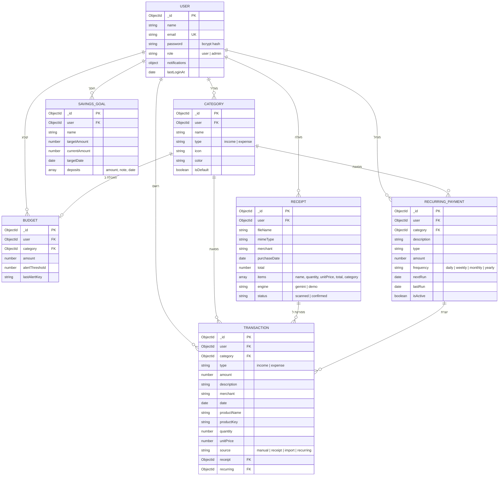

### 5.2 הקולקשיינים

| קולקשיין | תיאור | אינדקסים |
|---|---|---|
| `users` | חשבונות משתמש. הסיסמה נשמרת מגובבת ואינה נשלפת כברירת מחדל (`select: false`) | `email` (ייחודי) |
| `categories` | קטגוריות הכנסה והוצאה של כל משתמש | `user + name + type` (ייחודי) |
| `transactions` | כל התנועות. שורת מוצר מקבלה נשמרת כעסקה עם `productName`, `quantity`, `unitPrice` | `user + date`, `user + category + date`, `user + productKey` |
| `budgets` | תקרה חודשית לקטגוריה. `lastAlertKey` מונע שליחה כפולה של התראה | `user + category` (ייחודי) |
| `recurringpayments` | הוראות קבע ומועד הביצוע הבא | `isActive + nextRun` |
| `savingsgoals` | יעדי חיסכון. ההפקדות נשמרות כמערך מוטמע (embedded) | `user` |
| `receipts` | מטא‑דאטה של קבלה והפריטים שזוהו. הקובץ עצמו נשמר בדיסק בשם אקראי | `user` |

### 5.3 החלטות תכנון

- **הטמעה מול הפניה**: הפקדות ליעד ופריטי קבלה תמיד נקראים יחד עם ההורה ואינם משותפים, ולכן הם מוטמעים. קטגוריה משותפת לעסקאות רבות, ולכן היא הפניה (`ref`).
- **המוצרים אינם קולקשיין נפרד**: קטלוג המוצרים מחושב מתוך העסקאות לפי `productKey` (שם מנורמל). כך אין כפילות נתונים, ומחיקת עסקה מעדכנת מיד את הקטלוג.
- **תאריכים ב‑UTC**: תאריך עסקי נשמר כחצות UTC, וכל חישובי החודש נעשים ב‑UTC, כדי שהתוצאה לא תלויה באזור הזמן של השרת.

---

## 6. ממשק ה‑API

ה‑API בנוי בסגנון REST: שמות עצם ברבים, פעלי HTTP סטנדרטיים וקודי סטטוס משמעותיים. התיעוד המלא של כל הנתיבים נמצא ב‑[api.md](api.md).

| משאב | נתיב בסיס | נתיבים |
|---|---|---|
| אימות | `/api/auth` | 5 |
| דשבורד ותובנות | `/api/dashboard` | 2 |
| עסקאות ו‑Excel | `/api/transactions` | 9 |
| קטגוריות | `/api/categories` | 4 |
| תקציבים | `/api/budgets` | 4 |
| יעדי חיסכון | `/api/goals` | 5 |
| הוראות קבע | `/api/recurring` | 5 |
| מוצרים | `/api/products` | 2 |
| קבלות | `/api/receipts` | 5 |
| דוחות | `/api/reports` | 1 |

מבנה תשובה אחיד: `{ success, data, meta? }` בהצלחה, `{ success: false, message, details? }` בשגיאה.

---

## 7. אבטחת מידע

| איום | הגנה | מיקום בקוד |
|---|---|---|
| גניבת סיסמאות ממסד הנתונים | גיבוב bcrypt עם 12 סבבים. הסיסמה לא נשלפת בשאילתות ולא מוחזרת ב‑JSON | `models/User.js` |
| ניחוש סיסמאות (Brute force) | עד 20 ניסיונות ב‑15 דקות לכתובת IP | `middleware/rateLimiter.js` |
| חשיפת קיום משתמש | אותה הודעת שגיאה לאימייל שגוי ולסיסמה שגויה | `managers/auth.manager.js` |
| זיוף זהות | JWT חתום (HS256) עם תוקף, נבדק בכל בקשה | `middleware/auth.js` |
| גישה לנתוני משתמש אחר (IDOR) | כל שאילתה ב‑repository כוללת `user: userId`. משאב של אחר מחזיר 404 | `repositories/base.repository.js` |
| NoSQL Injection | Joi מוודא טיפוסים, `express-mongo-sanitize` מסיר מפתחות `$` | `app.js`, `validators/` |
| Mass assignment | `stripUnknown` – רק שדות שהוגדרו בסכמה מגיעים ללוגיקה. אי אפשר לשלוח `role` או `user` | `middleware/validate.js` |
| ReDoS בחיפוש | escape לתווי RegExp בקלט המשתמש | `utils/text.js` |
| העלאת קובץ זדוני | הגבלת גודל, רשימת סוגים מותרת, בדיקת magic bytes, שמירה בשם אקראי, הגשה רק לבעלים | `middleware/upload.js`, `utils/fileSignature.js` |
| XSS | React מבצע escape לכל טקסט. כותרות אבטחה דרך helmet. escape ל‑HTML במיילים | `app.js`, `services/email.service.js` |
| חשיפת מפתחות | מפתח Gemini ופרטי SMTP רק בשרת, דרך משתני סביבה. `.env` לא נכנס ל‑Git | `config/env.js`, `.gitignore` |
| דליפת מידע בשגיאות | בסביבת production מוחזרת הודעה כללית בלי stack trace | `middleware/errorHandler.js` |
| שימוש יתר ב‑API בתשלום | מגבלת קצב נפרדת לנתיבי ה‑AI | `middleware/rateLimiter.js` |
| CORS | רק המקורות שהוגדרו ב‑`CLIENT_URL` | `app.js` |
| חשיפת מסד הנתונים | ב‑docker‑compose המסד ברשת פנימית בלי פורט חיצוני, והקונטיינר רץ כמשתמש לא‑root | `docker-compose.yml`, `backend/Dockerfile` |

**פרטיות מול ה‑AI**: להפקת תובנות נשלחים ל‑Gemini רק סכומים מצטברים ושמות קטגוריות, בלי פרטים מזהים. תמונת הקבלה נשלחת לפענוח רק כשהמשתמש בוחר להעלות אותה.

---

## 8. שירותים חיצוניים

### 8.1 Google Gemini API

| | |
|---|---|
| **שימוש 1** | פענוח קבלה: התמונה נשלחת עם הנחיה להחזיר JSON של בית עסק, תאריך ושורות מוצר, כולל שיוך לקטגוריות של המשתמש |
| **שימוש 2** | תובנות: סיכום מספרי של החודש נשלח, ומוחזרות 3 עד 5 המלצות קצרות |
| **פרוטוקול** | `POST https://generativelanguage.googleapis.com/v1beta/models/{model}:generateContent`, המפתח בכותרת `x-goog-api-key` |
| **עמידות** | timeout של 45 שניות, תרגום כשלים לשגיאת 502 ברורה, ניקוי ואימות של ה‑JSON שחוזר |
| **בלי מפתח** | פענוח קבלה מחזיר קבלת הדגמה שמסומנת בבירור במסך. תובנות מחושבות במנוע כללים מקומי |

### 8.2 דואר אלקטרוני (SMTP באמצעות Nodemailer)

| מייל | מתי נשלח |
|---|---|
| ברוכים הבאים | בסיום הרשמה |
| התראת תקציב | כשהניצול עובר את סף ההתראה, ושוב כשעוברים 100%. פעם אחת לכל רמה בחודש |
| סיכום חודשי | ב‑1 בכל חודש, למשתמשים שלא ביטלו |

בלי הגדרות SMTP המיילים לא נשלחים אלא נרשמים ל‑log, כך שאפשר לפתח ולהדגים בלי שרת דואר.

---

## 9. תרשימי תכנון

### 9.1 Use Case

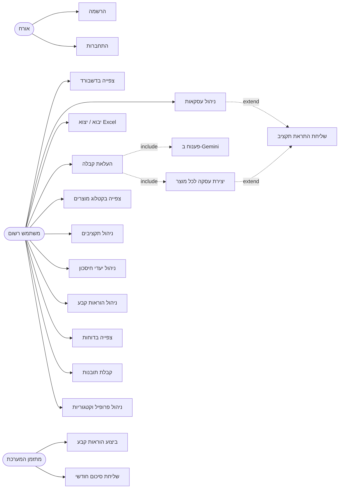

### 9.2 Sequence – העלאת קבלה

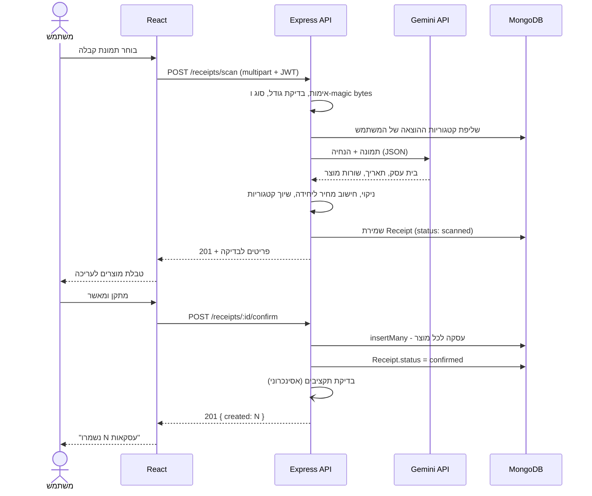

### 9.3 Sequence – התחברות וגישה למשאב מוגן

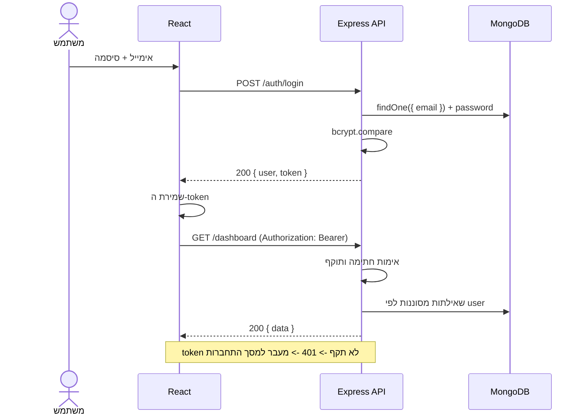

### 9.4 Activity – ביצוע הוראות קבע (Job יומי)

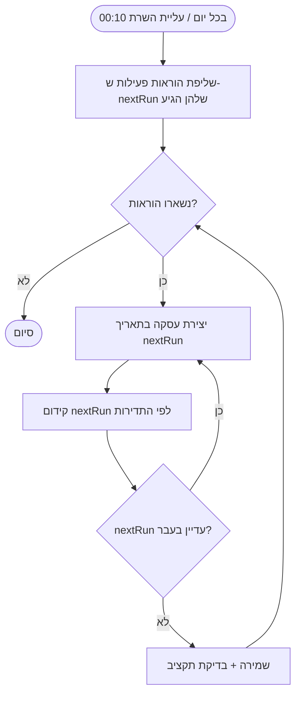

---

## 10. אלגוריתמים מרכזיים

כל החישובים נמצאים ב‑`backend/src/utils/finance.js` כפונקציות טהורות ומכוסים בבדיקות יחידה.

### 10.1 ניקוד בריאות פיננסית (0 עד 100)

```
ציון = 0.4 × חיסכון + 0.3 × עמידה בתקציב + 0.3 × מגמת הוצאות
```

| מרכיב | חישוב |
|---|---|
| חיסכון | שיעור החיסכון החודשי חלקי יעד של 20%, מוגבל ל‑100. חיסכון של 20% ומעלה = 100 |
| עמידה בתקציב | אחוז התקציבים שלא נחרגו. בלי תקציבים = 100 |
| מגמת הוצאות | 100 אם ההוצאה החודש אינה גבוהה מממוצע שלושת החודשים הקודמים. מעבר לכך יורד בקו ישר עד 0 בחריגה של 50% |

רמות: 80 ומעלה "מצוין", 60 ומעלה "טוב", 40 ומעלה "דורש תשומת לב", מתחת לכך "מאתגר".

### 10.2 תחזית סוף חודש

כשיש היסטוריה: מה שנרשם עד היום + הממוצע של מה שנרשם **אחרי היום הזה בחודש** בשלושת החודשים הקודמים. כך תשלום שכר דירה ב‑1 בחודש לא מוכפל ב‑30. בלי היסטוריה: ממוצע יומי עד היום, מוכפל בימים שנותרו. בשני המקרים הוראות קבע שטרם בוצעו הן רף תחתון.

### 10.3 סטטוס יעד חיסכון

```
אחוז צפוי = הזמן שעבר מיצירת היעד / כל הזמן עד תאריך היעד
```

אם האחוז שנחסך נמוך מהאחוז הצפוי, היעד "מפגר". ההפקדה החודשית הנדרשת היא הסכום שנותר חלקי מספר החודשים שנותרו.

### 10.4 המקום המשתלם ביותר למוצר

הקניות של מוצר מקובצות לפי בית עסק. המקום המשתלם הוא זה שהמחיר **האחרון** בו הוא הנמוך ביותר (ובשוויון, הממוצע הנמוך). "חיסכון אפשרי" הוא ההפרש בין המחיר בקנייה האחרונה למחיר הזה.

---

## 11. מסכי המערכת

הצילומים נעשו מהמערכת הרצה עם נתוני ההדגמה (`npm run seed`).

### התחברות
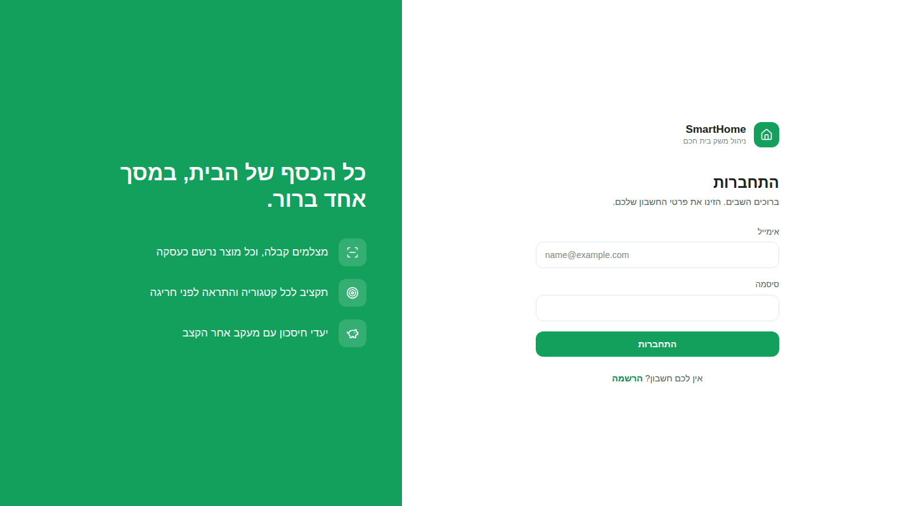

### דשבורד
סיכום החודש, ניקוד בריאות פיננסית, תובנות, גרף שישה חודשים, פילוח קטגוריות, תחזית, יעדים, לוח הוצאות יומי, עסקאות אחרונות ומצב התקציבים.


### עסקאות
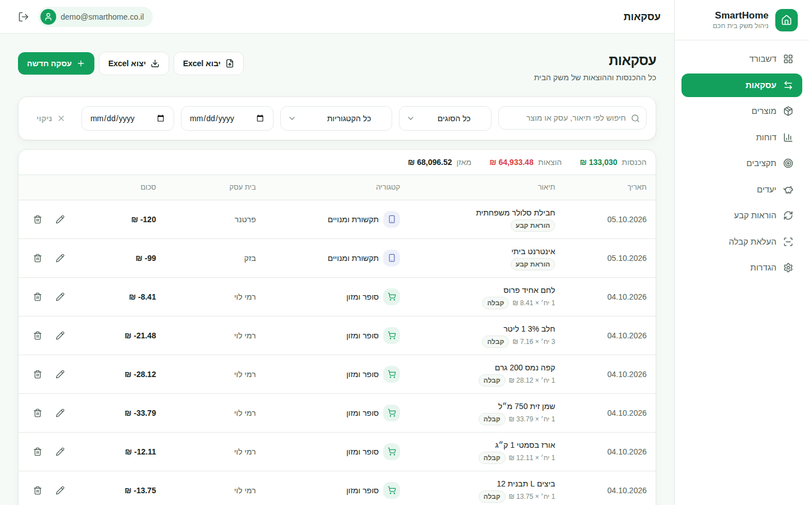

### טופס עסקה
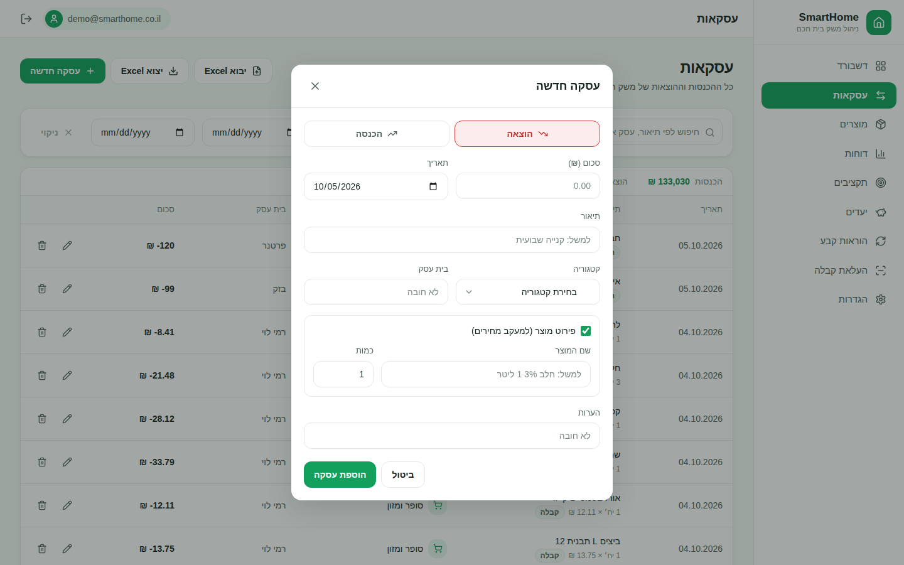

### קטלוג מוצרים
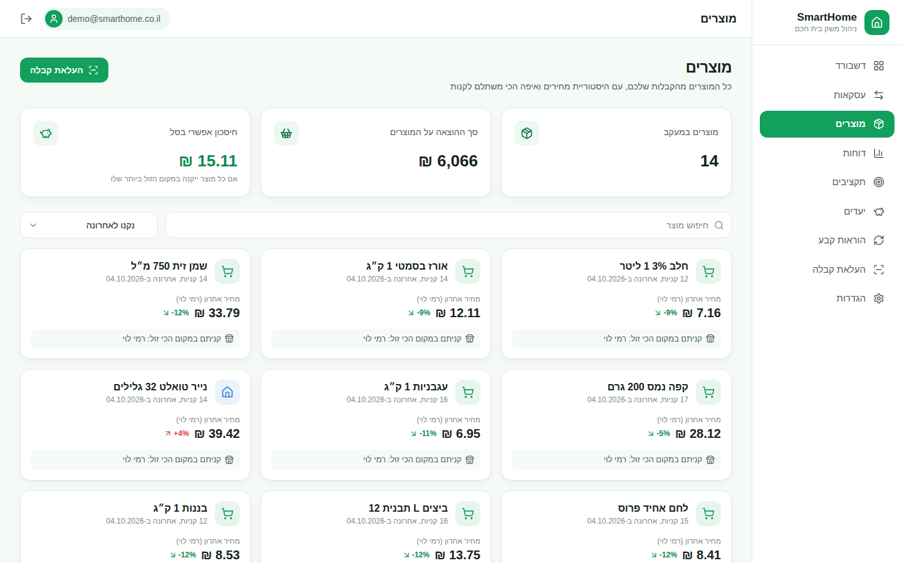

### פירוט מוצר – היסטוריית מחירים והשוואת בתי עסק
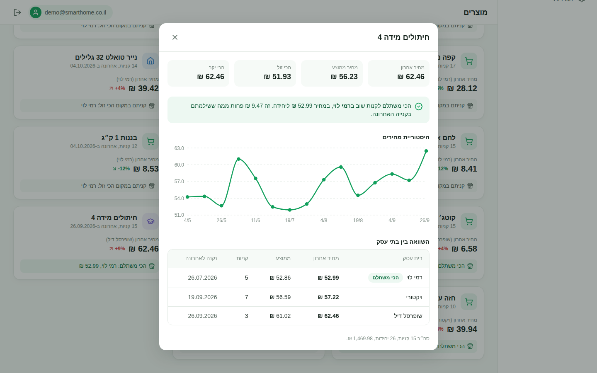

### דוח חודשי
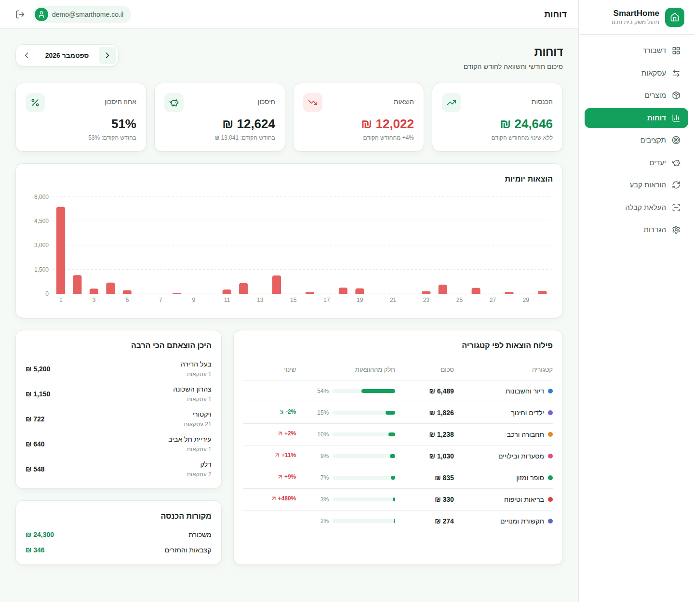

### תקציבים
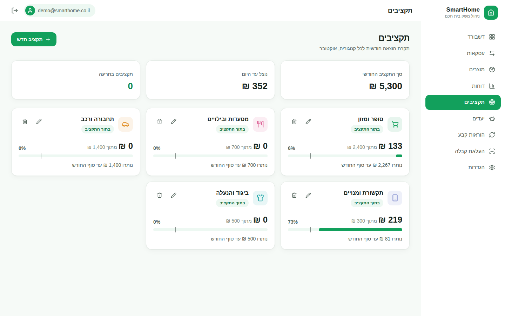

### יעדי חיסכון
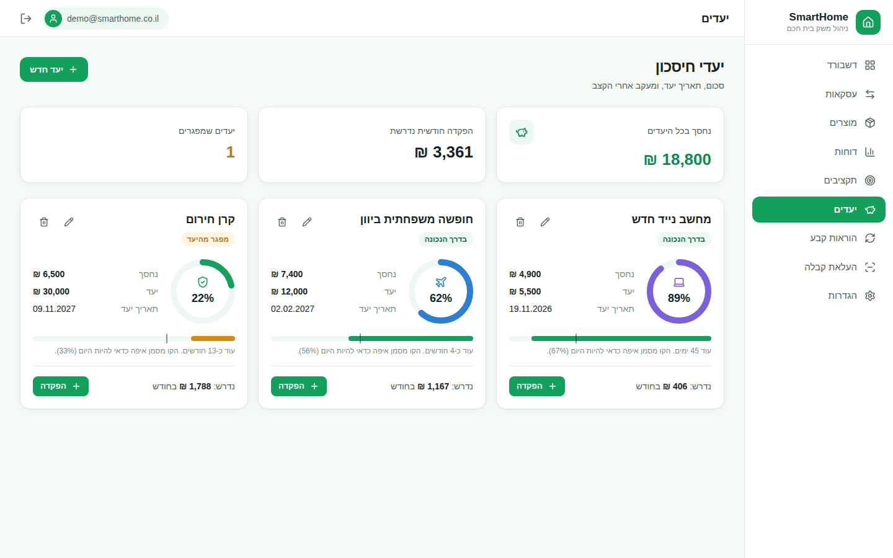

### הוראות קבע
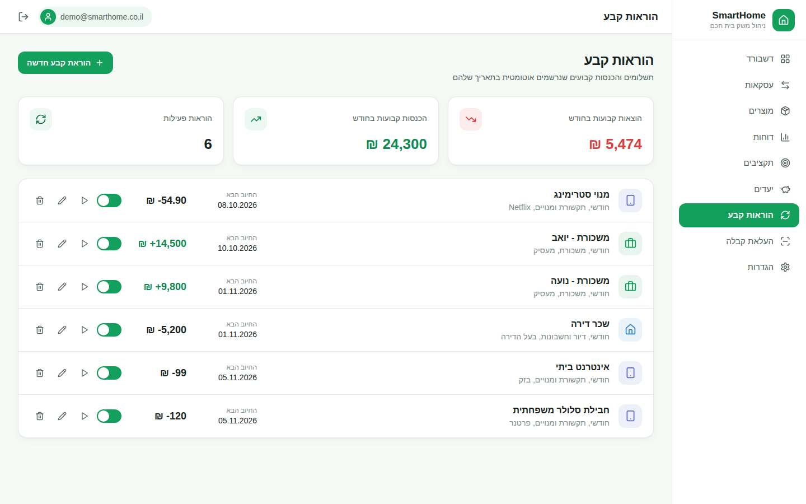

### העלאת קבלה – בדיקת המוצרים שזוהו
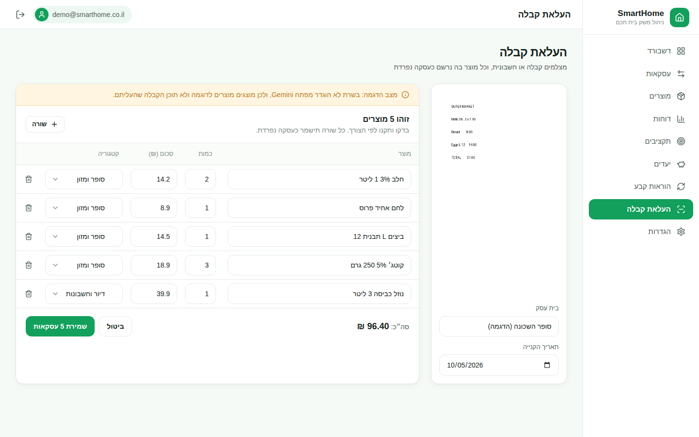

### הגדרות
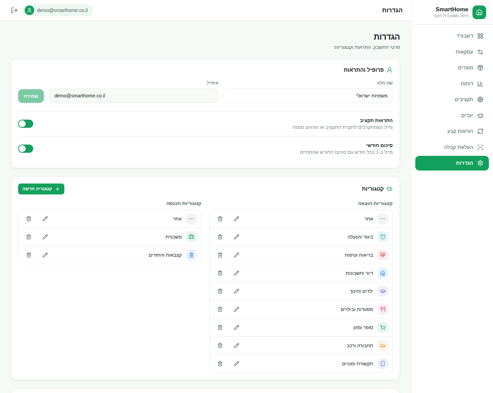

### תצוגת טלפון
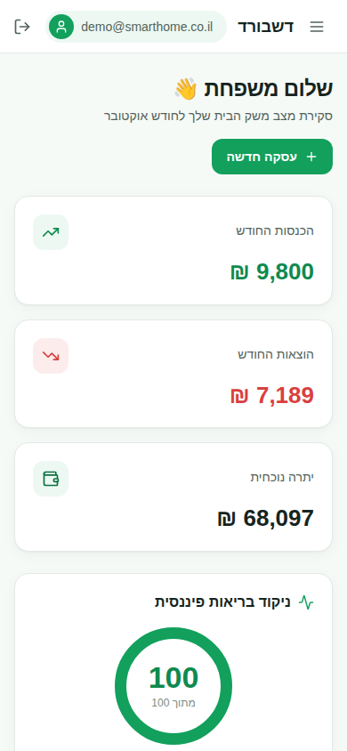

---

## 12. בדיקות

### 12.1 בדיקות יחידה אוטומטיות (Jest)

הרצה: `cd backend && npm test`

| קובץ | מה נבדק |
|---|---|
| `tests/finance.test.js` | סיכום לפי סוג, אחוז שינוי, ניקוד בריאות (4 תרחישים), תחזית (עם ובלי היסטוריה), סטטוס יעד (3 מצבים) |
| `tests/dateUtils.test.js` | טווח חודש, מעבר שנה, שנה מעוברת, קידום הוראת קבע כולל סוף חודש קצר |
| `tests/security.test.js` | זיהוי סוג קובץ לפי תוכן, דחיית קובץ מתחזה, escape ל‑RegExp, דחיית סיסמה חלשה, סינון שדות לא מורשים, דחיית אופרטור NoSQL |

### 12.2 תרחישי בדיקה מקצה לקצה

התרחישים רצים מול שרת פעיל בסקריפט `backend/scripts/smoke-test.js` (`npm run smoke`), שמדפיס לכל קריאה את קוד הסטטוס ואת השדות המרכזיים.

| # | תרחיש | תוצאה צפויה |
|---|---|---|
| 1 | הרשמה עם אימייל חדש | 201, מוחזר token, נוצרות 12 קטגוריות, הסיסמה לא מוחזרת |
| 2 | התחברות עם סיסמה שגויה | 401, "האימייל או הסיסמה שגויים" |
| 3 | בקשה בלי token או עם token פגום | 401 |
| 4 | יצירת הוצאה עם פירוט מוצר וכמות 5 | 201, `unitPrice` מחושב, `productKey` נוצר |
| 5 | יצירת הוצאה עם קטגוריית הכנסה | 400, "הקטגוריה אינה מתאימה לסוג העסקה" |
| 6 | יצירת עסקה עם סכום שלילי ותאריך לא תקין | 400 עם פירוט השדות |
| 7 | חיפוש "חלב" וסינון לפי חודש | רק עסקאות מתאימות, סכומים ודפדוף נכונים |
| 8 | יצוא ל‑Excel ויבוא חוזר של אותו קובץ | כל השורות תקינות והקטגוריות מזוהות |
| 9 | יבוא CSV בסגנון בנק (סכומים שליליים, קטגוריה לא מוכרת) | שלילי = הוצאה, חיובי = הכנסה, קטגוריה חסרה מסומנת |
| 10 | העלאת קובץ טקסט בשם `.xlsx` או `.jpg` | 400, התוכן אינו תואם לסוג |
| 11 | הוצאה שעוברת את התקציב | `lastAlertKey` מתעדכן ונשלח מייל אחד |
| 12 | תקציב שני לאותה קטגוריה | 409 |
| 13 | הפקדה ליעד, ומשיכה גדולה מהיתרה | היתרה מתעדכנת, המשיכה נדחית ב‑400 |
| 14 | "ביצוע עכשיו" להוראת קבע חודשית | נוצרת עסקה, `nextRun` מתקדם בחודש |
| 15 | סריקת קבלה, אישור, ואישור חוזר | 5 עסקאות נוצרות, האישור השני נדחה ב‑409 |
| 16 | משתמש ב' מנסה לגשת ליעד או לקטגוריה של משתמש א' | 404 / 400, אין דליפת מידע |
| 17 | עדכון פרופיל עם `role: "admin"` בגוף הבקשה | השדה מסונן, התפקיד לא משתנה |
| 18 | מחיקת קטגוריה שיש בה עסקאות | 409 עם מספר העסקאות |

### 12.3 בדיקות איכות קוד

`npm run lint` בשני הצדדים (ESLint), ו‑`npm run build` לצד הלקוח. שלושתם רצים אוטומטית ב‑GitHub Actions בכל push.

---

## 13. התקנה, הרצה ופריסה

### 13.1 הרצה מקומית

דרישות: Node.js 18 ומעלה, MongoDB מקומי או חשבון MongoDB Atlas.

```bash
# שרת
cd backend
cp .env.example .env        # לעדכן MONGO_URI ו-JWT_SECRET
npm install
npm run seed                # נתוני הדגמה: demo@smarthome.co.il / Demo1234
npm run dev                 # http://localhost:5000

# לקוח (בטרמינל נוסף)
cd frontend
npm install
npm run dev                 # http://localhost:5173
```

### 13.2 הרצה ב‑Docker

```bash
cp .env.example .env        # לקבוע JWT_SECRET
docker compose up -d --build
# http://localhost:8080
```

שלושה קונטיינרים: `mongo`, `api` ו‑`web` (nginx שמגיש את ה‑build של React ומעביר `/api` לשרת). המסד נמצא ברשת פנימית בלבד.

### 13.3 משתני סביבה

| משתנה | חובה | תיאור |
|---|---|---|
| `MONGO_URI` | כן | כתובת מסד הנתונים |
| `JWT_SECRET` | כן ב‑production | מפתח החתימה של ה‑JWT |
| `JWT_EXPIRES_IN` | לא | תוקף ה‑token (ברירת מחדל: 7 ימים) |
| `CLIENT_URL` | כן | מקורות מותרים ל‑CORS, מופרדים בפסיק |
| `GEMINI_API_KEY` | לא | בלי מפתח: מצב הדגמה |
| `GEMINI_MODEL` | לא | ברירת מחדל: `gemini-flash-latest` |
| `SMTP_HOST / PORT / USER / PASS` | לא | בלי הגדרה: המיילים נרשמים ל‑log |
| `ENABLE_JOBS` | לא | `false` מכבה את המשימות המתוזמנות |

### 13.4 תהליך CI

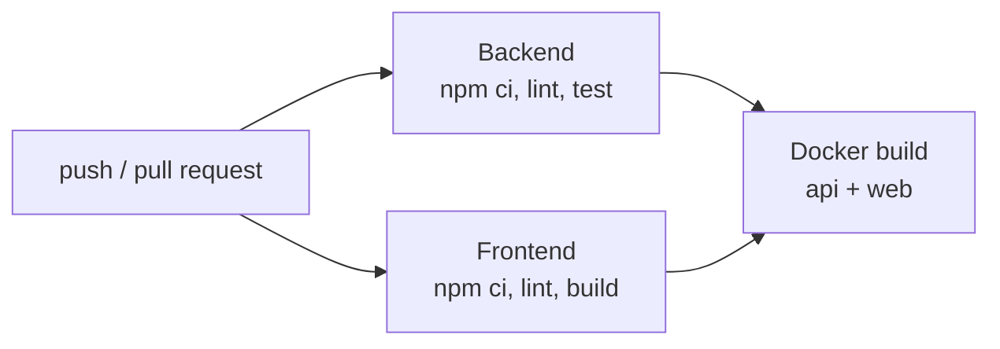

---

## 14. ניהול גרסאות

המאגר מנוהל ב‑Git בשיטת feature branches: לכל יכולת ענף נפרד שממוזג ל‑`main` ב‑merge commit. הודעות ה‑commit בתקן Conventional Commits (`feat`, `fix`, `test`, `docs`, `chore`, `ci`).

| ענף | תוכן |
|---|---|
| `chore/project-setup` | מבנה הפרויקט וכלי הפיתוח |
| `feature/backend-foundation` | Express, הגדרות, middleware וטיפול שגיאות |
| `feature/data-model` | מודלים ו‑repositories |
| `feature/auth` | הרשמה, התחברות, פרופיל וקטגוריות |
| `feature/transactions` | עסקאות ו‑Excel |
| `feature/budgets`, `feature/goals`, `feature/recurring` | תכנון פיננסי |
| `feature/receipts-ocr`, `feature/products` | קבלות וקטלוג מוצרים |
| `feature/dashboard-reports` | דשבורד, תובנות ודוחות |
| `test/backend` | בדיקות יחידה |
| `feature/ui-*` | מסכי צד הלקוח |
| `chore/devops` | Docker ו‑CI |
| `docs/project-book` | תיעוד |

---

## 15. סיכום והרחבות עתידיות

### 15.1 מה הושג

מערכת Full‑Stack מלאה עם 7 קולקשיינים, 42 נתיבי API, 11 מסכים, שני שירותים חיצוניים, בדיקות אוטומטיות וסביבת פריסה.

### 15.2 אתגרים ופתרונות

| אתגר | פתרון |
|---|---|
| תחזית סוף חודש לא ריאלית כשתשלום גדול יורד בתחילת החודש | מעבר מממוצע יומי פשוט לתחזית שנשענת על דפוס החודשים הקודמים |
| ה‑AI מחזיר לפעמים שדות חסרים או טקסט סביב ה‑JSON | שכבת ניקוי ונרמול, ומסך בדיקה שבו המשתמש מאשר לפני שמירה |
| סימן המינוס והמטבע מתהפכים בטקסט מימין לשמאל | פונקציית עיצוב אחת שמוסיפה סימן כיווניות (LRM) לפני הסכום |
| מניעת גישה לנתוני משתמש אחר בלי לזכור זאת בכל שאילתה | מחלקת בסיס ל‑repository שמוסיפה את מזהה המשתמש לכל פעולה |

### 15.3 הרחבות אפשריות

- משק בית משותף: כמה משתמשים עם הרשאות על אותם נתונים.
- חיבור ישיר לבנק ולחברות האשראי (Open Banking).
- סנכרון ל‑Google Sheets.
- Refresh tokens ואימות דו‑שלבי.
- אפליקציית מובייל (React Native) על אותו API.
- בדיקות אינטגרציה אוטומטיות מול מסד נתונים בזיכרון.

### 15.4 רפלקציה אישית

_להשלמה על ידי המגיש/ה: מה למדתי, מה הייתי עושה אחרת._

---

## נספחים

- [תיעוד ה‑API המלא](api.md)
- קוד המקור: תיקיות `backend/` ו‑`frontend/`
